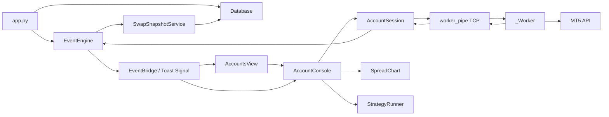
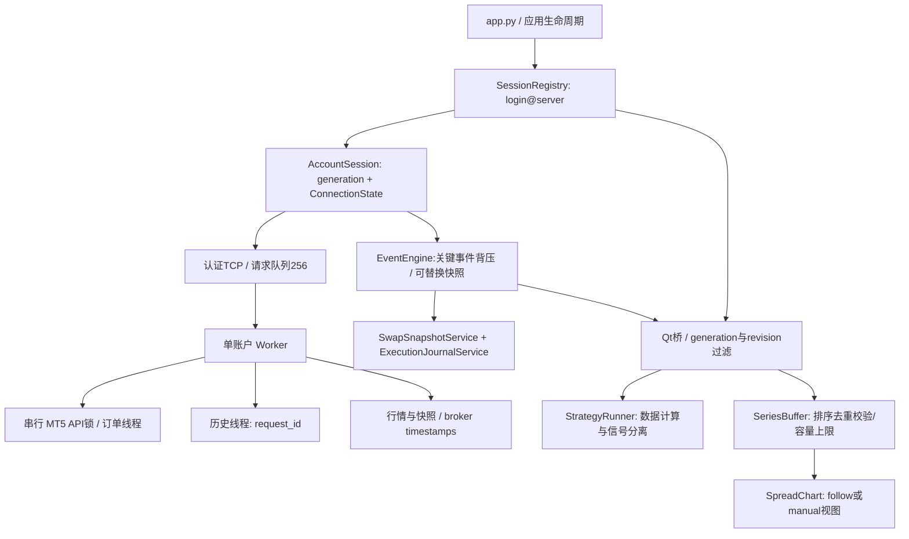

> **版本说明：本文件保留首轮审计结论和当时的验证记录。** 用户随后要求继续修复，自动实盘归属/开平仓、恢复、风控、Qt快照积压及打包配置已有第二轮实现；请以 [第二轮修复报告](FOLLOWUP-2026-10-15.md) 和当前README为当前状态。首轮的101个测试函数、40个源文件是当时静态计数，当前证据见static-validation.txt。所有轮次均未运行测试或MT5。

# CFDInterestARB 静态审计、架构修复与交付记录

日期：2026-10-15（Asia/Taipei）。事实来源：当前仓库源码、配置、git diff、静态语法解析。初始分支 main，开始时工作区干净。

**交付状态：已实施代码修复；未完成运行验收。** 用户明确要求 macOS 上不运行项目、MT5 或测试，只审查代码修复。因此本文中的“已修改”不等于“运行验证通过”；不能据此认定可实盘部署。没有创建真实账户连接，没有下单，没有启动 GUI。

## A. 项目现状和根因

项目为原生 Python 桌面程序：PySide6 GUI、pyqtgraph 图表、numpy 数值计算、SQLite 持久化、psutil 终端发现、Windows MetaTrader5 API。每个账户一个 worker 子进程，TCP JSON-lines 连接主进程。不存在 React/Web 前端、npm 构建、已有 mypy/ruff 配置或可执行文件打包目标。

### 原始数据流（依据调用方核对）

连接状态原本散落在 worker 的 `_connected/_link_lost`、session 的 `_stopped`、console 的 `_conn_state` 和账户表单元格中。状态只随一次性事件传播，表格刷新后没有权威快照可重建；控制台“断开”复用了窗口销毁逻辑，永久注销事件桥，重连不能恢复数据。会话停止顺序反了，stop 请求被自身标志拒绝；错误地对 Popen 调用 join；心跳失败后后续 stop 直接返回。启动先启动子进程再 listen，还有 GUI 同步 accept 阻塞。

图表库本身没有在源码审查中被证明存在缺陷。确认的问题是集成和数据契约：未经排序的历史被直接传入 searchsorted；旧实时点覆盖最新值；每 tick 用 np.append 复制全部数组且无容量上限；每次 redraw 强制坐标导致无法平移缩放；阈值对象频繁重建；空图清理不完整；文本坐标混用了像素意图与价格单位。

交易安全问题超出了原始两个入口：账户身份校验不完整、买单侧价错误、不确定回执重试、IOC 部分成交未进入对冲、无效腿被删后仍执行、停止时继续消费新委托、成交复核错误比较整个账户净仓与单次算法目标。自动监测没有调用实盘执行函数，与 README 说法不符；不能把未实现功能写成已验证功能。

## B. 问题台账与修改

以下问题由静态调用路径确认，表示存在确定代码缺陷，不表示已复现真实资金损失。所有测试列均指**已编写的待运行用例或 Windows 手工验收步骤**。

| 编号/优先级 | 文件/函数 | 触发、根因及影响 | 实际修改 | 测试/验收标准 |
|---|---|---|---|---|
| T01 / P0 | worker `_connect/_poll_snapshot/_build_market/_build_close/_build_cancel` | 同 login 不同 server、终端人工换号；重连不校验身份，可能对错误账户发单 | 统一 login+server+terminal.connected 校验；每次 order_send 前在 API 锁内校验；不向错误账户发布账户/持仓快照 | `test_same_login_on_wrong_server_cannot_trade`、断线拒单；Windows 人工切账号时不能产生委托 |
| S01 / P1 | account_session `start/stop/_run/_writer` | stop 被 `_stopped` 自拒绝、Popen.join 无效、writer 阻塞、handler 遗留 | 单次 generation、后台 start、先监听再 spawn、单写线程发送 stop；Popen.wait→terminate→kill；注销、关闭、join 清理 | `test_writer_delivers_stop_before_closing_transport`、重复 start、EOF；Windows 无孤立 worker |
| S02 / P1 | account_session / session_registry / connection_state | 重复连接、迟到事件、失败无法恢复；缺少权威所有者 | registry 按 login@server 持有 session；显式合法状态迁移、revision、generation；停止完成前禁止同账户/同终端重建 | registry 重用/多账户/旧代次测试；重连只保留一个 worker |
| S03 / P1 | accounts_view `_reload`、console 生命周期 | 表格重建丢状态；断开与关闭共用销毁路径；回调参数错误 | 表格从 session 快照恢复；断开保留桥；关闭只销毁视图、连接归 registry；根退出停止所有账户；回调签名统一 | `test_accounts_reload_reads_authoritative_state`、断开后订阅仍在、重复窗口创建清理 |
| S04 / P1 | worker_pipe / worker `_connect` | attach 等待时主循环未读 stop/ping，可能误判死亡或取消失败；未认证本地连接 | stop/ping 在独立 IPC reader；随机 token 经 stdin 传递，握手后才传配置；不传密码；启动前确认绑定终端进程存在 | Windows 启动/登录等待期间取消与心跳；当前未做实际协议压测 |
| Q01 / P1 | event_queue / event_engine / worker_pipe | 拥塞时任意丢弃命令、成交、状态；handler 集合并发修改 | 满载只替换 tick/account/position/order 快照；关键事件阻塞背压；handler 注册/读取加锁；停止前排空；pipe 断裂后停止 worker 并排空本地回复 | 队列保留回执、关键队列显式 Full、Windows 慢消费者压力验证 |
| T02 / P1 | worker `_handle_order/_build_market/_build_close` | 买单和平空使用 bid；None 结果被自动重发，成交未知可能重复下单 | 买方向取 ask；仅明确的 REQUOTE/PRICE_OFF/PRICE_CHANGED 重试；None 仅报告未确认；单单校验手数/身份/行情时龄；平仓校验 ticket | buy/sell 侧价、None 单次发单测试；不同 broker filling/滑点仍需测试 |
| T03 / P1 | worker `_start_spread_algo/_on_algo_leg_result/_algo_hedge_passive` | 部分成交当拒单；非法腿静默删除；失败仍发后续腿；比例计算错误 | 整篮子先验证；处理 DONE_PARTIAL；按实际主动腿成交比例缩放；对冲量先缩放再减已成交；失败中止；步长后零腿明确告警；UUID 算法号 | 部分成交与比例回归、非法篮子零发单；部分对冲剩余敞口需人工处理，不伪装成功 |
| T04 / P1 | worker `run/_order_loop`、app 退出 | stop 后排队单仍发；MT5.shutdown 可发生在两条对冲腿之间 | stop 禁止新单；等待当前订单事务/历史/轮询/监视线程再 shutdown；父进程有限等待后告警强杀；应用停止会话→排空事件→关闭 DB | `test_stop_cancels_queued_orders`；Windows 在途成交退出验证 |
| T05 / P1 | worker `_algo_leg_audit` | 多层/人工仓混在账户净仓中，单层目标与整个账户比较产生假告警/假成功 | 记录每个算法的 deal IDs；只对这些成交复核；缺记录/账号不匹配明确失败；成功文案只表示本算法成交量匹配 | Windows 多算法+人工仓+延迟历史回执；不宣称已经建立策略持仓账本 |
| T06 / P1 | strategy / console | 未开启监测仍消耗层数；同门槛连续开层；纸面 close 永不清计数；实时统计混用 H1 | emit_signal 分离；下一未占网格层才触发；纸面 close 后复位；live 统计仅用 live 样本；历史刷新保留实时尾部 | 显示不耗层、distinct grid、prior 清理、live/H1 分离；原网格错误期望已改并扩展测试 |
| T07 / P1（未完整实现） | console `_handle_strategy/_execute_live` | 自动监测只记录，与“每层实盘下单”说明矛盾；close 若复用执行函数会变开仓；缺策略持仓归属 | 界面如实写“手动实盘 / 自动仅信号”；max_positions 标为最大信号层；保留手动开仓；非 open 请求禁止进开仓函数；没有擅自用账户仓位自动平仓 | 自动开平仓闭环仍未完成；需策略/账户/position_id 账本、重启恢复、成交驱动计数后再实现 |
| H01 / P1 | console 历史请求、worker history loop | A→B→A 旧结果签名相同；四位权重签名冲突；失败无响应；空数据仍 ready；60s 节流挡住恢复 | 唯一 request_id + 精确组合签名；成功/失败响应；30s 超时后可重试；有效 H1≥2且图表非空才 ready；线程单请求异常不击穿 | 同组合旧请求拒绝、关联失败回复、错误后重试；真实历史超时场景待测 |
| H02 / P1 | console `_on_tick/_update_header_line`、worker ticks | 旧报价每0.2s重发被当新行情；腿缓存跨断线；重复帧虚增统计 | 保留 broker time_msc；各腿有限值/正价/时龄≤15s/偏差≤5s；同帧去重；断线清缓存，过期暂停监测；订阅集合按组合替换 | quote freshness/跨腿 skew、重复帧；阈值为保守工程默认，Windows 校钟与市场场景待校准 |
| C01 / P1 | series_data / chart | 旧点写到最新时刻；历史排序/去重/非有限数据无校验；内存无限增长 | 单一标准化函数；同刻替换、旧 live 丢弃；历史排序同刻最后值；平行数组长度不符拒绝；双容量连续缓冲，最多200k点 | 无效/重复/乱序、200k/250k输入、2000次容量压缩、历史合并 |
| C02 / P2 | chart 生命周期/交互 | 禁缩放平移；每 tick 强制跳回；阈值每次重建；空图残线；tooltip 越界 | follow/manual 两模式；手动视图增量刷新不改坐标；恢复跟随按钮；阈值对象复用；UTC轴；比例坐标tooltip；可见错误文案；dispose timer/scene signal | Qt 历史/live/清空重建、手动视图保持、timer dispose、阈值对象复用；真实鼠标和截图未验证 |
| D01 / P2 | database `sync_terminals` | 扫描删缺失路径，账户 terminal_id 悬空且无法显示原绑定 | 不再隐式删除已记录路径；UI显示失效以便重绑 | `test_scan_preserves_missing_bound_terminal` |
| D02 / P2 | account_dialog / accounts_view / accounts | attach 却必填密码；9位登录号限制；编辑主键变新增；活跃绑定可修改 | 密码可空且不发IPC；登录号正整数64位范围；编辑锁定身份；活跃会话先断开才能改绑定；防重复新增绕过校验；修改后关闭旧配置视图；保留未展示的symbols；明确未绑定非自动 | Windows 对话框边界；现存 password 列保留兼容，旧明文数据未删除 |
| F01 / P1 | weights / constants / worker swap payload | 2/3/4币种枚举口径错误；points tick_value 二次错换汇；6/7/8当年息；字段名不一致 | 2基础币/3保证金币/4账户币；points按账户币换汇；6/7/8缺必要输入返回不可估值；双兼容contract字段；拒非有限汇率；SVD保留欠定零空间 | swap币种/points/reopen回归；实际安装MT5枚举及broker账单待Windows核对；mode5为FX名义近似 |
| D03 / P2 | db_service `ExecutionJournalService` | 关闭控制台后成交反馈没有持久消费者 | 应用级记录 order result/algo event 到已有 trades 表；信号行标signal、实际回执标execution；不做不明归属的仓位推断 | 无控制台时记录回执；退出排空服务 |
| U01 / P2 | notify / base / console close | Toast没有随控制台关闭注销；重复hook重复连接Qt槽；旧代次提示污染 | 显式dispose；绑定槽一次；generation过滤；机会计算增加协作取消；错误retcode文案修正 | 重复创建关闭控制台后handler回到基线 |
| U02 / P2 | console `_on_positions` | 同品种多笔持仓浮盈字典覆盖只剩最后一笔 | 按symbol累加 | Windows 同品种多个ticket对账 |
| R01 / P3 | terminals 注册表遍历 | 子注册表key未关闭 | finally CloseKey | 静态检查；Windows资源检查待执行 |

## C. 架构变化与取舍

### 当前所有权和事件流

- Registry 唯一拥有活跃会话；MainWindow/AccountsView/Console 只持引用。相同 login@server 重复连接重用；相同终端不允许多个未清理账户同时使用。
- worker 的连接事实来自 API；主进程 session 将其转为不可变状态快照，记录 revision。每个 IPC/请求事件附 generation，重建连接后不复用旧会话对象。
- 订阅状态由 worker 的 `eSymbols` 确认，与连接状态分开；报价可用性按各腿 broker 时间校验，与 TCP心跳分开。没有增加“data_ready=True”来冒充行情有效。
- 页面切换不影响会话。关闭控制台只销毁视图并停监测；显式断开、删账户、退出才停止会话。重开控制台恢复连接事实，组合/监测状态重新建立，不自动恢复交易意图。
- 应用重启只恢复 SQLite 账户和终端配置，连接默认不存在，纸面默认开启。不能持久化“已连接”作为事实。
- 连接合法图：disconnected→connecting→connected；connecting/connected→reconnecting→connected；活跃态→failed 或 stopping；stopping→disconnected/failed。failed 的对象先清理，重连由 registry 创建新 generation。
- 历史请求由控制台维护请求意图，worker 负责拉取；`generation + request_id + legs` 校验后才更新 runner/chart。切换组合会清缓冲、停监测、更新订阅；新历史保留其尾部之后的live点。
- 队列对关键事件采用有界背压，避免静默丢回执。慢消费者可能增加延迟，尤其同一MT5锁上的历史/订单竞争；不是吞掉数据来伪造实时性。事件线程在队列饱和时重入分发可能改变跨事件嵌套次序，调用方不能依赖全局严格FIFO；正常路径仍FIFO。后续压力验证必须覆盖该取舍。
- 执行日志与策略仓位账本严格分开：记录回执不表示已经知道净持仓归属或实现自动平仓。

### 图表方案评估

| 方案 | 与当前项目的适配 | 数据更新/交互 | 迁移代价与判断 |
|---|---|---|---|
| 保留 pyqtgraph | 已有PySide6原生集成、numpy数据；现有PlotDataItem/ViewBox能力足够 | setData、downsampling、复用对象；原有禁交互属于本项目实现选择 | 只需修复数据契约和视图所有权；采用此方案 |
| Lightweight Charts | 面向Web；仓库没有JS宿主或桥接层 | 金融时间序列适合，但Python状态要跨桥同步 | 新增WebEngine/JS构建/协议及销毁管理；没有证据说明能解决本项目根因，不迁移 |
| ECharts | 面向Web；适合通用多图表，但仓库目前主要是单价差折线 | 丰富数据展示，仍需Python↔JS桥接 | 更大迁移面，无法消除历史竞态/无界缓存，不迁移 |

版本和许可证的证据边界：仓库仅声明 `pyqtgraph>=0.13.7`、`PySide6>=6.6`，没有锁文件、安装清单或第三方许可证副本；安装已按用户要求中止。因此不能确定实际部署版本，也没有完成许可证审查、维护活跃度调查、候选库性能对测。常见上游许可证信息不能代替当前实际发行物核查。发布前应锁定在Windows验证过的版本并整理许可证通知；本次没有用未经运行的最新版替换依赖。

图表改造属于**数据模型与视图控制重构**，不是替换图表库。迁移保留 set_series/append_point/thresholds 等接口，增加 preserve_live、dispose；旧 K线 no-op 接口暂保留兼容，没有把它们计为实现了K线。

### 兼容性和迁移

- SQLite schema 保持不变。新增 execution 日志使用现有 trades 表，mode=live/action=execution；外部读取该表的代码应区分 signal/paper/execution，不能把每条记录当成交。
- MainWindow、AccountsView、AccountConsole 构造现在需要传入应用的 SessionRegistry；仓库调用链已同步。
- IPC 仅内部使用：新增启动认证、generation、request_id、订阅集合替换。不要混用新父进程和旧 worker 源码；更新后整体重启应用。
- 弃用“关闭控制台即断开”的旧行为；使用“断开会话”按钮。根窗口退出仍统一清理。
- 先前错误swap币种枚举和网格测试期望已同步改正，未删除原测试函数。不可估值的swap模式可能减少机会数量，这是避免输出错误收益的有意行为变化。

## D. 验证证据

| 验证项目 | 实际结果 | 证据或限制 |
|---|---|---|
| 初始git状态 | 已检查，干净main | git status --short、git branch --show-current |
| 原始单元测试 | 未执行成功 | 最初python3 -m pytest提示No module named pytest；后续用户禁止运行，未再执行 |
| 依赖安装 | 已取消 | .venv pip安装被中止；没有安装MT5，没有更改requirements生产版本 |
| 源码语法 | 已静态解析 | Python标准库ast.parse读取40个Python源文件；无项目import，无测试执行；最终日志见static-validation.txt |
| diff格式 | 已检查 | git diff --check，无输出/退出0；不等于Lint或类型检查 |
| 单元/集成测试 | 已补源码，未运行 | 原60个测试函数+新41个=101个函数（静态计数，不等于pytest收集/通过数） |
| 类型检查 | 未执行 | 原仓库没有配置；依赖未安装完整，按用户约束未运行mypy |
| Lint | 未执行 | 未运行ruff；不把AST解析称为Lint通过 |
| 生产构建 | 未执行/原仓库未定义 | 无pyproject构建配置或PyInstaller/spec目标；未擅自引入打包栈 |
| 连接生命周期 | 静态核对+待执行测试 | 状态机/代次/EOF/stop/重复连接/账户隔离代码；真实启动/超时/重连/失败恢复须Windows |
| 图表核心功能 | 静态核对+待执行Qt测试 | 历史/空数据/实时/乱序/容量/视图保持/销毁源码；没有渲染截图或实际交互证据 |
| 关键业务回归 | 静态核对+待执行测试 | 买卖侧价、错账户拒单、None不重试、部分成交、swap换算、网格等；没有真实broker执行证据 |

Windows后续操作见 `WINDOWS-VALIDATION.md`。测试使用注入MT5与本地socketpair验证代码协议，不能把测试通过等同真实终端连通；实盘验收应使用用户授权的模拟账户。

## E. 遗留事项和风险

1. **P1：自动实盘开平仓闭环未实现。** 现有代码没有可恢复的策略仓位归属、ticket/position_id 分配、净持仓账户冲突规则。不能安全把整个账户仓位作为某策略的平仓目标。本次修正误导说明与危险入口，保留手动实盘开仓；不宣称完成自动交易功能。
2. **P1：Windows/真实MT5全部待验证。** attach-only预检查可防止通常的自动拉起，但终端在进程检查与initialize之间退出仍存在外部API竞态；MT5没有由本仓库证明的绝对“不拉起”保证。包括terminal_info、broker枚举、成交回执、filling方式、超时、断线恢复、多终端隔离。
3. **P1：异常重启后的在途委托结果恢复尚不完整。** 收到的执行回执已持久化；若订单被broker接受后worker在回执前崩溃，没有自动查单恢复或幂等键。代码不自动重发，仍需终端人工对账。
4. **P2：强制退出仍可能中断未知在途订单。** 父进程等待35秒，随后terminate/kill并记录风险。无限等待会导致应用无法退出；当前取舍需要Windows长延迟验证，不能保证所有网络故障下无裸腿。
5. **P2：金融模型近似与支持范围。** 历史使用bid close加当前点差近似ask，并非历史可成交价；mode5收益仍为FX名义近似；6/7/8不估值。无swap日历/节假日/三倍日完整收益模拟。多腿目标方向与货币维度的全面数学验证尚未完成；典型三角公式已有测试，但不代表所有2~5腿组合均正确。
6. **P2：真正的策略风控仍缺失。** 最大信号层只是纸面信号计数，不是broker持仓上限；手动下单尚无账户级名义/保证金/损失限制。已更正标签，不能把它当实盘风险管理系统。
7. **P2：Qt跨线程与高压延迟待测。** 机会生成在图遍历/组合评估间检查取消，正在进行的单次numpy调用无法中途取消；Qt queued signals本身尚无应用层容量上限；事件引擎快照替换只能限制上游队列。历史API持同一锁仍可能影响订单延迟，不能重复旧README的“毫秒级”承诺。
8. **P2：凭据与日志。** attach不再要求/传输密码，但历史SQLite的明文password列保留兼容，未删除用户数据；需要独立迁移策略才能清除或转系统凭据库。执行日志包含账户/委托元数据，应按本地敏感数据管理。
9. **P2：无部署依赖锁/许可清单/打包基线。** 本次不安装、不运行，没有解决发行版可复现性；应在Windows完成后固定实际依赖。
10. **P3：保留的未统一模块。** `SpreadCombo.calculate_price` 的线性盘口与runner的乘法价差是不同接口；当前控制台采用后者。需独立评估是否移除旧接口，不能静默改变已有调用契约。图表K线兼容方法仍no-op。

## F. 最终状态

已完成当前可执行范围内的静态审计、问题定位、上述代码修改、回归测试源码和文档同步。连接与图表核心缺陷已有对应实现调整，交易/持久化/UI相关问题也已按风险处理。所有行为测试、Qt渲染、MT5运行、Lint、类型与构建均没有运行通过证据。

**本次原始完整验收标准尚未达到。** 原因是用户主动限制运行验证，以及自动实盘闭环/策略持仓归属等遗留事项。静态复查未发现仍未处理的确定性新语法错误；这不能证明没有运行回归。交付为待Windows验证的源码变更，不是已验收的实盘发行版。
