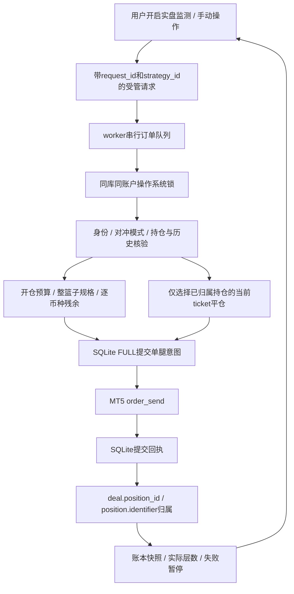

# 第二轮修复报告：受管实盘、恢复与工程补齐

日期：2026-10-15。事实范围为当前工作树，承接首轮审计。用户要求只审查代码，不运行应用、MT5或测试；本轮没有安装依赖、执行测试、启动GUI/worker或操作任何真实账户。

## A. 本轮结果与根因

首轮已纠正连接状态、图表和多项执行缺陷，但自动监测仍只有信号，缺少持仓归属及崩溃恢复，因此不能安全接通自动下单。第二轮新增持久化受管执行层并将GUI的手动/自动实盘都接到该路径。支持范围明确限制为对冲账户中的FOREX合约（trade_calc_mode 0/5）；净持仓账户、其他CFD计算模式拒绝受管执行。

这是已写入源码的行为，不是已通过模拟盘或实盘验收的功能。默认仍为纸面；实盘必须由用户设置风险上限、取消纸面模式、核验账本并主动开始监测。应用重启不恢复自动交易意图。

## B. 修改台账

| 编号/优先级 | 根因及触发 | 实际修改与文件 | 待验证标准 |
|---|---|---|---|
| M01/P1 | 信号即计层，重启后不知哪些持仓属于策略 | managed_trading.py增加managed_requests/managed_batches；SignalEngine.restore_counts与console从worker账本恢复实际层数 | 发单失败不占真实层；重启后层数与成交账本一致 |
| M02/P1 | 发单后崩溃可能丢回执，无法判断是否应重发 | request_id永久去重；每次broker调用前FULL同步提交意图，之后提交回执；未知结果保持阻断 | 各崩溃点不自动重发；落盘失败则不进入下一次broker调用 |
| M03/P1 | 账户净仓可能混有人工/其他策略仓位 | 按开仓deal.position_id与position.identifier核验归属，再以当前ticket平仓；当前持仓与历史数量不一致则拒绝 | 只平指定策略方向，人工与其他策略仓位不变；净持仓账户零发单 |
| M04/P1 | 未确认、部分成交后仍可能继续开层 | 账本blocked态阻止全部新增风险；已核验的剩余归属仓位可由明确平仓请求退出；未知归属不猜测 | 部分对冲/部分平仓后暂停；未知结果不能借平仓入口重复发送 |
| M05/P1 | 没有账户预算，GUI信号上限不约束实际交易 | 真实每方向层数、账户总手数（含人工仓）、保证金预算、挂单检查、trade_allowed/trade_expert、IOC及order_check整篮子预检 | 无预算、挂单、超预算、非法规格均在第一腿前拒绝；不会宣称是完整损失风控 |
| M06/P1 | 多进程同账户可同时通过预算检查 | 同数据库/账户的操作系统文件锁，覆盖恢复/检查/执行；进程退出释放锁 | 第二进程竞争失败，不产生重复交易；不同数据库副本不受同一锁保护 |
| F02/P1 | 手数中性默认所有合约相同；取整可破坏中性 | weights/opportunities纳入contract_size；发单前按当前买卖侧报价验证逐币种残余不超最大单腿流5%；部分主动成交后再核对缩放篮子 | 不同合约大小权重正确；取整残余超限不发第一腿；主动部分成交无法对冲时明确阻断 |
| F03/P1 | 合成被排除买腿时仍用卖目标的幂方向，价格单位倒置 | spreads/strategy/worker统一以目标方向调整价格幂；修正原错误测试期望 | 2至5腿闭环中每个目标的合成价格维度一致；历史/live口径一致 |
| Q02/P2 | 上游有界但Qt queued tick仍持续积压 | EventBridge对tick/account/position/order按账户合并，只排一次Qt唤醒；关键事件不合并 | 暂停UI消费后快照内存不按tick数增长；成交/状态仍完整 |
| D04/P2 | attach界面仍允许收集无用途密码，旧值回填UI | account_dialog取消新密码输入；保留旧字段兼容，并提供显式删除旧密码选项 | 新增账户不收集密码；编辑不显示旧值；仅用户勾选后清空该账户字段 |
| B01/P2 | 无生产打包入口；冻结exe不能使用python -m启动worker | 新增spec、requirements-build、pyproject检查配置；--worker分支与冻结数据库可写目录 | Windows打包后子进程进入worker；完整账本迁移后恢复一致；实际构建待执行 |
| T08/P2 | 原测试默认Database()会写用户真实库 | 原测试改为只检查default_database_path()；注入测试使用临时SQLite | 测试运行不得修改真实账户数据库 |

## C. 执行、归属与恢复

- `managed_requests`以账户+request_id唯一，避免重发相同请求。claim之后尚未产生订单意图时崩溃，不会再执行该ID；用户可根据账本重新提出新的操作。
- `managed_batches`保存策略、方向、腿、订单意图、broker回执、归属持仓和状态。每个发送意图有独立comment，回执持久化在下一腿发送之前。磁盘错误会阻断后续发送。明确发生在order_send之前的本地校验失败单独记录not_sent，避免把行情过期等已知未发单误当永久未知结果。
- 已知成交必须能通过成交历史复核，再与当前持仓数量/方向/品种/magic对上。只记录信号、只有账户净仓、只收到成功文本都不足以建立归属。
- 未知结果用精确comment+magic+品种+方向+请求数量匹配唯一历史订单，要求终态、无活跃挂单，且成交量等于历史订单已执行量。证据充分时只读恢复；缺记录不代表没成交，保留blocked。
- 全部腿完成但来不及提交complete时，恢复后保守标为blocked，不自动继续开层；确认归属后可退出仓位。不会在重启时补发未完成的被动腿。
- 外部人工减仓可由完整历史确认剩余数量，批次标blocked；外部增仓、反转或归属冲突不自动接管。原有未登记仓位不自动认领。
- 自动平仓只作用于当前策略方向；“平策略持仓…”用于选择其他已恢复策略方向。暂停监测或关闭控制台不会隐式平仓。
- 原order/spread_algo IPC不再允许无归属执行。旧内部算法辅助实现暂保留作迁移对照，新增测试覆盖实际生产使用的ManagedExecutor；旧测试不能单独证明新路径正确。

## D. 验证证据

本轮新增tests/test_managed_trading.py，扩展test_chart_ui.py、test_audit_regressions.py、test_spreads.py。相对首轮新增24个测试函数，全仓库125个函数（参数化函数按一个计数），不是pytest收集数或通过数。

| 检查 | 实际状态 | 范围 |
|---|---|---|
| AST源代码解析 | 已执行，最终日志见static-validation.txt | 42个.py源码，另解析.spec；不import项目 |
| 本地from-import名称核对 | 已用AST静态核对 | 不代表第三方导入可用或类型正确 |
| pyproject TOML解析 | 静态读取 | 不执行pytest/ruff/mypy |
| git diff --check | 已执行 | 只检查差异格式 |
| 单元/集成/Qt/MT5测试 | 未执行 | 遵从用户禁止本地运行的约束 |
| Lint/类型/构建 | 未执行 | 只新增配置，不声称通过 |
| Windows多进程文件锁/冻结exe | 未执行 | 必须在目标系统验证 |
| 依赖锁与许可证检查 | 未完成 | 没有实际安装清单，不能伪造锁定版本或许可验收 |

## E. 剩余边界与风险

1. **运行验收仍全部待Windows。** broker回执、历史延迟、comment保留情况、margin_mode、IOC、position.identifier和操作系统锁均需要模拟环境验证。源码存在不等于功能可靠性已证明。
2. **未知结果不一定能自动解除。** broker改写comment、历史不完整或归属冲突时保持阻断，需终端人工核对；没有“忽略异常继续交易”的入口。不要通过删库/换库绕过。
3. **净持仓账户与非FOREX合约不在自动实盘支持范围。** 净仓分配需要独立账户/策略分摊规则，无法从当前库推断。没有擅自采用FIFO分配人工仓位。
4. **风控不是最大损失保证。** 实现了手数、保证金、实际层数和残余检查；未实现账户最大回撤、止损/强平管理、跨应用或不同账本副本的全局风控。外部EA/人工仍可能在检查之后改变账户。
5. **多腿不是原子成交。** 主动腿成交、对冲失败或强制杀进程仍可能留敞口；落盘和恢复使其可追踪，不保证任何故障下都没有裸腿。当前设计不自动补发或自动反向回滚未知交易。
6. **金融估值仍有近似。** 历史ask由当前点差近似，mode5仍是名义年息估值；6/7/8不估值；未补完整节假日/三倍swap日历收益模拟。5%残余阈值沿用原模型，是待校准容差而非收益保证。
7. **Qt关键事件队列与API延迟仍需压力验证。** 高频快照已合并，关键事件必须完整交付；未把关键事件也当可丢快照。历史和受管执行共享MT5锁，长历史查询仍可能延迟交易。
8. **敏感字段未做物理擦除。** 清空旧password仅更新当前SQL字段，旧WAL/备份可能仍有内容；没有在用户机器上执行数据库迁移或清理。
9. **部署版本与许可仍待实际发行环境确认。** 新spec未编译；未锁版本；使用console模式保留worker标准流。源码与exe的数据库默认路径不同，必须完整迁移且避免并行副本。

## F. 当前交付状态

已补齐对冲FOREX账户的受管自动开平仓源码、持久归属与恢复、预算限制、UI快照合并、密码入口和工程配置。原始完整运行验收仍未达到，不能认定无行为回归或可直接用于真实资金。最终静态检查记录、Windows验证清单及README已同步，所有修改仍在当前工作区，未提交或推送。
